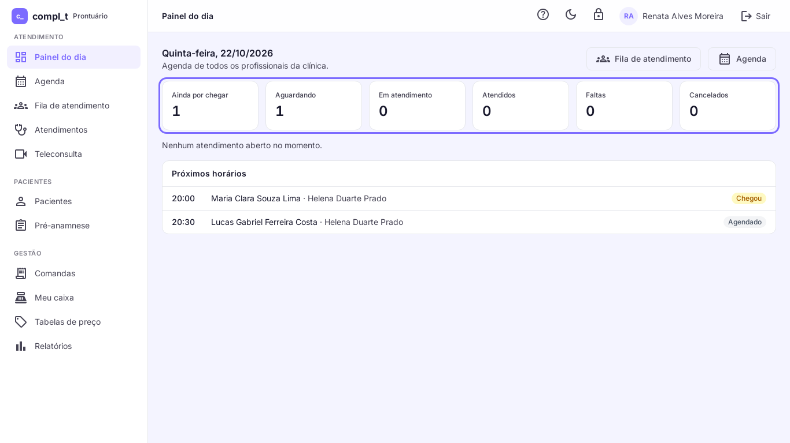
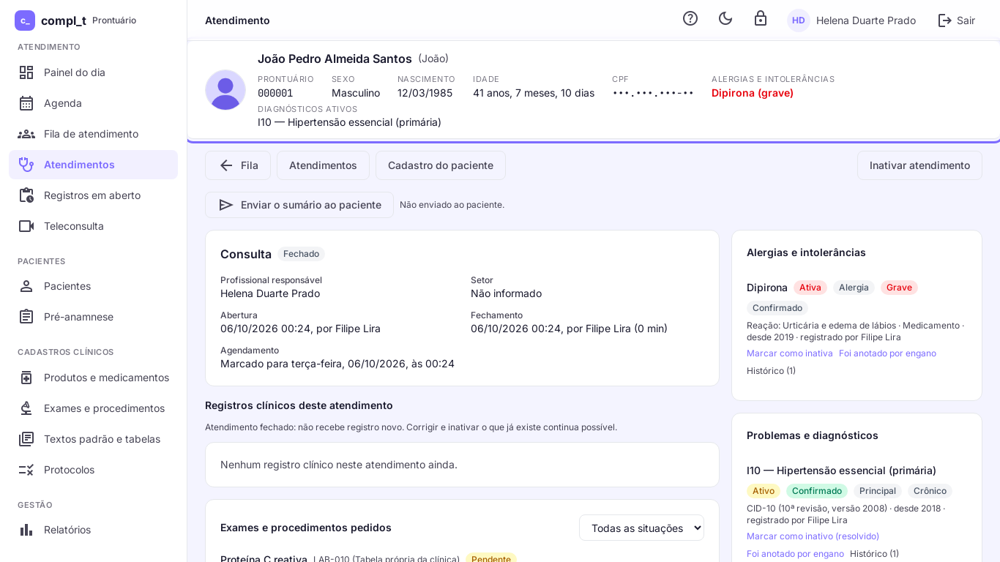

# PEP compl_t: engenharia de um SaaS crítico, de ponta a ponta

> Estudo de caso de engenharia de software, por **Filipe Lira**. O código é privado; aqui estão **as decisões, a qualidade e os resultados**.
> Domínio: prontuário eletrônico para clínicas, um sistema em que erro custa caro. As telas usam dados fictícios.

---

## Em uma frase

Um SaaS multi-cliente com 13 módulos, API e telas no mesmo repositório, construído por **uma pessoa** com engenharia assistida por IA, com **29 versões em menos de um mês** e QA em cada entrega.

## Meu papel

Tudo: arquitetura, backend, frontend, banco, infraestrutura, deploy, QA e o processo de trabalho.

## Desafios de engenharia

| Desafio | Como resolvi |
|---|---|
| **Isolar clientes de verdade** | um banco, um usuário de banco, uma chave de criptografia e uma pasta de arquivos por cliente. Vazar dado entre clientes exige furar o banco, não basta um `WHERE` esquecido. Novo cliente entra por comando, sem mexer no servidor web. |
| **Dado que não pode ser alterado** | registros críticos são protegidos por **gatilho no próprio banco**: nem a aplicação, nem um script, nem um acesso direto conseguem mudar o que já foi registrado. Correção é um registro novo, com motivo e autor. |
| **Regras que mudam sem deploy** | critérios de negócio não ficam no código: vão para um painel de configuração com valor padrão, explicação e auditoria de quem mudou e quando. |
| **Atualizar sem medo** | versão SemVer por tag, changelog por módulo, backup automático antes de toda atualização, contagem de registros antes e depois e volta para a tag anterior. |
| **API e tela sem desencontro** | uma branch e um PR levam API e tela juntas; tipos TypeScript compartilhados são a fronteira entre as duas. |
| **Ambiente igual em todo lugar** | containers Debian 12 idênticos no desenvolvimento e em produção. |
| **Vídeo em tempo real** | teleconsulta com servidor de vídeo próprio, ligada ao restante do sistema. |

## Qualidade em números (até 28/10/2026)

| | |
|---|---|
| Versões publicadas | **29** em 25 dias |
| Testes automatizados | **435** (PHPUnit) |
| Roteiros de navegador | **30** (Playwright), com **226** capturas geradas sozinhas |
| QA automático em produção | **33** verificações por rodada |
| Módulos | **13** |
| Lições de engenharia registradas | **237**, cada uma virando regra para o erro não voltar |

## Como a qualidade é garantida

- **Quem fecha uma entrega é o QA, não quem escreveu o código.** O QA confere os critérios de aceite e o caminho errado; reprovou, volta.
- **Toda entrega nasce com critérios de aceite escritos antes do código.**
- **Manual de uso sempre em dia:** um teste falha se nascer uma tela sem manual, e as capturas do manual são geradas por roteiro.
- **Erro repetido é falha de processo:** o conserto vai para a regra que deveria ter evitado o erro, não só para o código.

## Engenharia assistida por IA

O sistema foi construído com IA como par de programação. O que faz funcionar é o processo em volta: papéis separados (produto, desenvolvimento e QA), testes que decidem o que vale e sessões trabalhando em paralelo sem pisar uma na outra. **O modelo propõe; o teste decide.**

Resultado: velocidade de equipe com o controle de qualidade de um sistema crítico.

## Telas (dados fictícios)

| Painel do dia | Atendimento |
|---|---|
|  |  |

## Stack

PHP 8.3 · Laravel · PostgreSQL 16 · Redis 7 · Vue 3 · TypeScript · Pinia · Tailwind · Vite · Docker · PHPUnit · Playwright · LiveKit

**Demonstração ao vivo:** sob pedido, numa conversa.

## Outros cases

[plataforma-case](https://github.com/filipelira1/plataforma-case) · [crm-case](https://github.com/filipelira1/crm-case) · [mermaid-case](https://github.com/filipelira1/mermaid-case) · [pacs-case](https://github.com/filipelira1/pacs-case)

---

*Sou **Filipe Lira**, engenheiro de software em São Paulo (ABC Paulista). [LinkedIn](https://www.linkedin.com/in/filipe-lira-a54217167) · [GitHub](https://github.com/filipelira1)*
